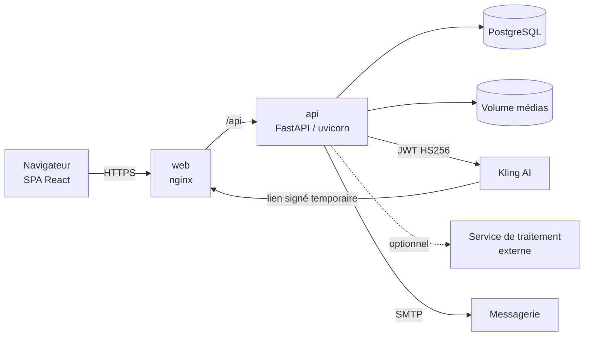
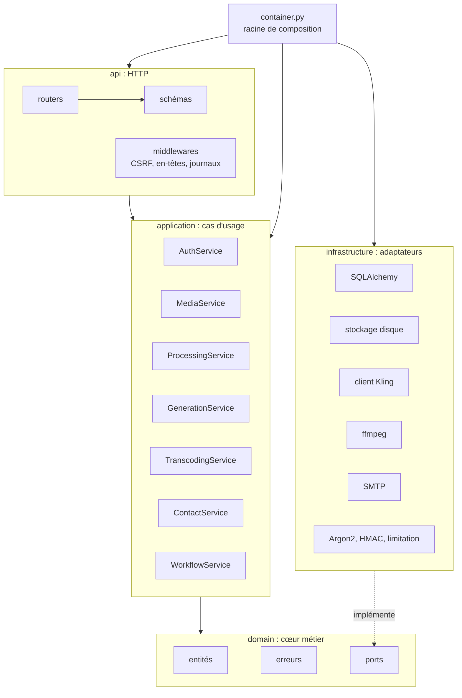
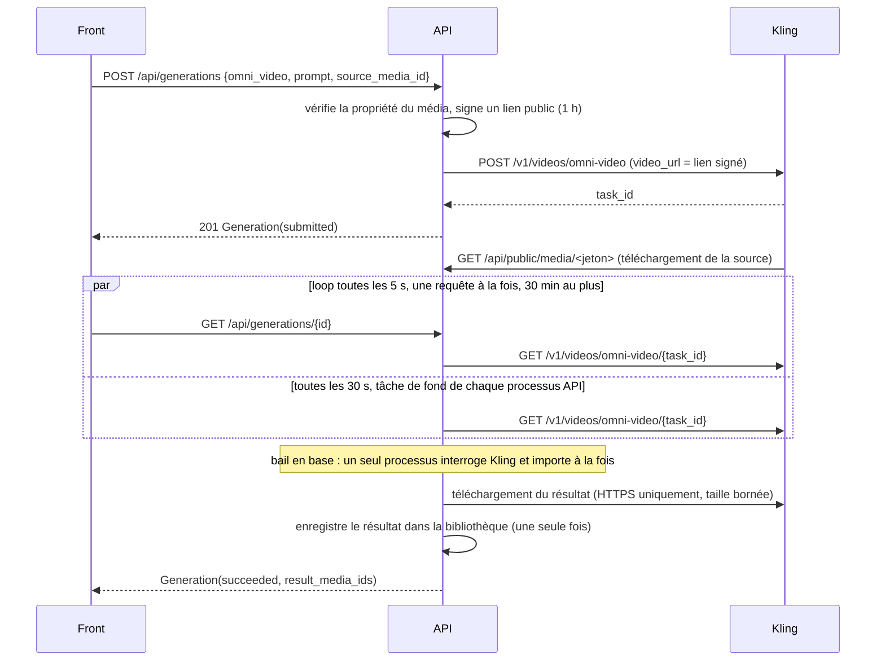
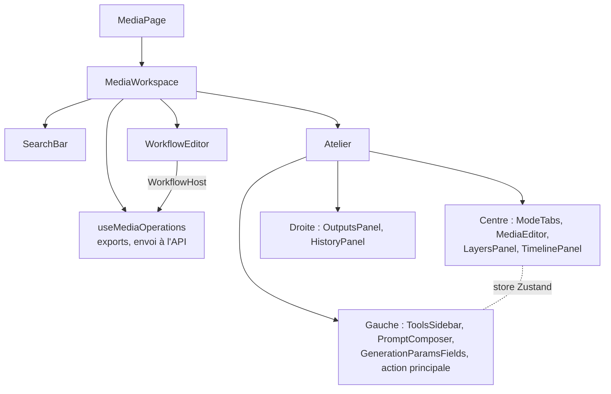

# Architecture

## Vue d'ensemble



- Le navigateur ne parle qu'à une seule origine : nginx sert la SPA et relaie `/api` vers l'API.
  Les cookies de session restent donc `HttpOnly` et `SameSite`, sans CORS.
- La base de données n'est sur aucun réseau sortant (`internal: true` dans compose).
- Kling Omni-Video doit télécharger la vidéo source : l'API lui fournit un lien signé par HMAC,
  valable une heure (`/api/public/media/<jeton>`), au lieu d'exposer les dossiers de médias.
- Les workflows sont exécutés dans le navigateur ; le serveur les stocke et en vérifie la
  structure. Chaque étape passe par l'API publique, avec les droits de l'utilisateur.

## Backend : architecture en couches



**Règle de dépendance** : `domain` ne dépend de rien ; `application` ne dépend que de `domain` ;
seule la racine de composition (`container.py`) connaît les implémentations concrètes.

Chaque requête HTTP reçoit une unité de travail (une session SQLAlchemy, donc une transaction)
autour de laquelle sont construits les services dont la route a besoin. Les objets coûteux
(moteur SQL, clients HTTP, stockage, sémaphore des conversions) sont créés une fois au démarrage.

### Principes SOLID appliqués

| Principe | Application concrète |
|---|---|
| Responsabilité unique | un service par cas d'usage (`application/*.py`) ; les routers ne font que traduire entre HTTP et service ; la traduction des erreurs est centralisée dans `api/errors.py` |
| Ouvert/fermé | ajouter un fournisseur IA (par exemple Hugging Face) consiste à écrire un adaptateur du port `GenerationProvider` ou `MediaProcessor`, sans modifier les services ; côté frontend, un type de nœud de workflow est un fichier découvert automatiquement |
| Substitution de Liskov | `EchoMediaProcessor` et `HttpMediaProcessor`, `ConsoleMailer` et `SmtpMailer`, SQLite et PostgreSQL sont interchangeables ; la suite de tests tourne à l'identique sur les deux bases |
| Ségrégation des interfaces | ports petits et ciblés (`domain/ports.py`) : `FileStorage`, `UrlSigner`, `RateLimiter`, `VideoTranscoder`... ; côté frontend, `WorkflowServices` n'expose que les appels utiles au moteur |
| Inversion des dépendances | les services reçoivent des abstractions (`Protocol`) ; `container.py` assemble les implémentations ; les tests injectent des doublures (`tests/fakes.py`, `features/workflow/test/fakes.ts`) |

### Flux : génération Kling Omni-Video



### Modèle de données

| Table | Contenu | Clés et index |
|---|---|---|
| `users` | nom d'utilisateur, email, empreinte du mot de passe | noms et emails uniques, comparés sans tenir compte de la casse |
| `sessions` | empreinte du jeton, utilisateur, expiration | clé primaire sur l'empreinte |
| `media` | propriétaire, type, origine (`upload`, `processed`, `generated`, `export`), nom d'origine, clé de stockage, taille, parent | index propriétaire et date ; parent mis à `NULL` à la suppression |
| `generations` | propriétaire, type, statut, prompt, paramètres (JSON), tâche du fournisseur, média source, résultats, bail de suivi | index propriétaire et date ; index statut et date de suivi |
| `workflows` | propriétaire, nom, graphe (JSON), dates | index propriétaire et date de modification |

Les migrations sont dans `backend/migrations/versions/` (Alembic).

## Frontend

```
src/
  app/              routeur, mise en page, fournisseurs
  pages/            une page assemble des fonctionnalités (aucune logique métier)
  features/
    atelier/        Atelier trois colonnes : modes, paramètres, sorties, historique
    workflow/       éditeur de graphe, registre des nœuds, moteur, modèles
    editor/         éditeur d'annotations (modèle, rendu, interactions, exports)
    assistant/      construction des prompts (fonctions pures) et bloc « Composition »
    generation/     suivi des générations Kling
    media/          upload (glisser-déposer, progression), cartes, bibliothèque
    search/         barre de requête et dictée vocale
    workspace/      espace de travail d'un média : onglets Atelier et Workflow
    auth/           session, garde des routes, redirection sûre
  shared/           client API typé (généré depuis OpenAPI), kit d'interface, hooks
```

- **Contrat généré** : `backend/openapi.json` produit `src/shared/api/schema.d.ts`
  (`make openapi`). La CI échoue si l'un des deux n'est pas à jour.
- **Modèle d'annotations** (`features/editor/model/types.ts`) : coordonnées en pixels natifs du
  média. C'est le contrat commun à l'éditeur, à l'assistant de prompts et au Workflow
  ([ADR 0003](adr/0003-coordonnees-natives.md)).
- Les pages et l'éditeur de graphe sont chargés à la demande (découpage du code par page et par
  onglet).

### Espace de travail : Atelier et Workflow



- `MediaWorkspace` possède l'éditeur (référence `MediaEditorHandle`), les opérations sur le média
  et la liste des sorties. Les deux onglets restent montés une fois ouverts : annotations,
  sorties et graphe sont conservés quand on passe de l'un à l'autre.
- L'Atelier calcule tout ce qui dépend du mode dans `features/atelier/model/modes.ts` (fonctions
  pures) : disponibilité selon le média, paramètres visibles, corps de la requête de génération,
  raison du blocage du bouton Générer.
- Le bloc « Composition » et le bouton Générer partagent `usePromptComposition` : le prompt affiché,
  son compteur et le prompt envoyé sont le même texte. Voir [ADR 0005](adr/0005-atelier-et-workflows.md).

### Workflow

- **Graphe** : nœuds et liens typés (`image`, `video`, `text`, `media`). L'éditeur (React Flow)
  refuse les liens incompatibles ; le format enregistré est indépendant de React Flow
  (`model/graph.ts`, `version: 1`).
- **Registre** : chaque type de nœud est un module `nodes/*.node.tsx` qui déclare ses ports, ses
  paramètres, son panneau et sa fonction `execute`. Le registre les découvre au build.
- **Moteur** (`engine/`, TypeScript pur) : validation (types, entrées manquantes, cycles), tri
  topologique, exécution séquentielle avec progression, arrêt sur demande et propagation des
  erreurs aux nœuds dépendants.
- **Dépendances injectées** : `WorkflowServices` (API) et `Clock` (attente) sont passés au
  moteur, ce qui permet de le tester sans réseau ni minuterie réelle ; `WorkflowHost` donne accès
  au média et aux annotations de l'Atelier.
- **Persistance** : `/api/workflows` (liste, création, lecture, remplacement, suppression), avec
  contrôle de structure et de taille côté serveur.

## Sécurité

Résumé ; le détail est dans [SECURITE.md](SECURITE.md).

| Sujet | Mesure |
|---|---|
| Authentification | session opaque (jeton aléatoire, seule l'empreinte SHA-256 est stockée), cookie `HttpOnly`, `Secure`, `SameSite=Lax`, expiration |
| Mots de passe | Argon2id ; anciennes empreintes werkzeug acceptées puis remplacées à la connexion |
| Force brute | limitation des tentatives par adresse IP (proxys de confiance seulement) et identifiant ; message d'erreur unique |
| CSRF | double-submit (cookie et en-tête `X-CSRF-Token`) sur toute écriture `/api` |
| Autorisations | chaque média, génération et workflow appartient à un utilisateur ; un objet d'autrui répond `404` |
| Uploads | type détecté par signature binaire (l'extension est ignorée), SVG refusé, tailles bornées, écriture atomique, noms de stockage générés |
| Contenu servi | `Content-Security-Policy` avec `sandbox` sur les médias, `nosniff`, CSP stricte sur la SPA |
| Appels sortants | résultats Kling en HTTPS uniquement et de taille bornée ; ffmpeg sans shell, concurrence et durée bornées |
| Configuration | refus de démarrer en production avec un secret faible ; secrets uniquement par l'environnement |
| Conteneurs | utilisateurs non-root, base sur réseau interne, sondes de santé |
